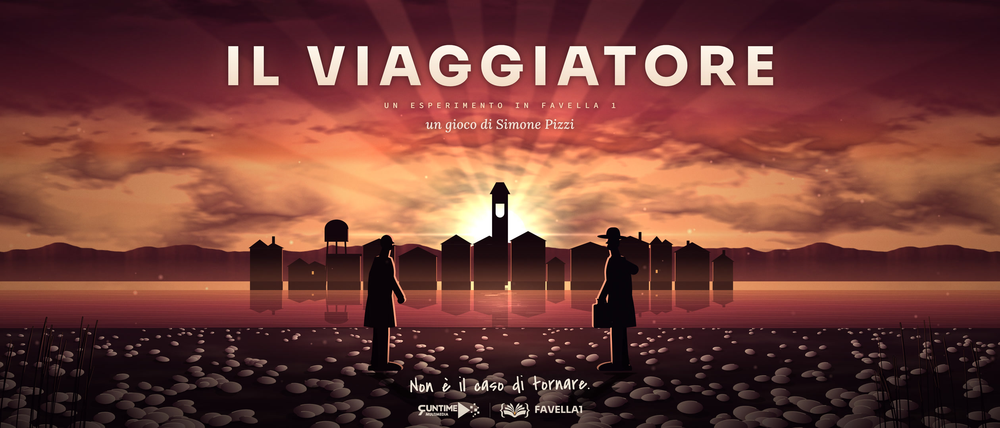

<p align="center">
  
</p>

<p align="center">
  Un'avventura testuale di sopravvivenza e cammino, scritta in <a href="https://github.com/Pitz72/FAVELLA1">FAVELLA 1</a>:<br>
  si scrive in italiano come nelle avventure classiche, o si gioca a clic, con le uscite, le cose e le risposte a portata di mano.<br>
  Un uomo torna a piedi a casa attraverso un sud rimasto senz'acqua.
</p>

<p align="center">
  <a href="https://github.com/Pitz72/il-viaggiatore-favella/releases/latest"><b>⬇ SCARICA IL GIOCO PER WINDOWS E LINUX</b></a>
  <br>in italiano e, dalla 1.40, in inglese
</p>

<p align="center">
  <b>QUESTO PROGETTO È CONCLUSO.</b><br>
  Il sorgente è aperto: si può studiare, e chi ama FAVELLA 1 è libero di estenderlo o di farne una propria versione.
</p>

---

Le lettere di tua moglie hanno smesso di arrivare. L'ultimo biglietto, in stampatello e
senza firma, dice soltanto: «Non è il caso di tornare.» Torni lo stesso.

**7 zone · 39 luoghi · 14 personaggi · 6 finali.** Si gioca scrivendo in italiano
(`bevi`, `parla con Rosaria`, `usa la lettera su Cosimo`), o toccando le uscite, le
cose e le risposte. La sete è la spina dorsale, l'acqua è la moneta, le scelte pesano.
Il gioco si apre con i loghi animati (e sonori) di Runtime Multimedia e di FAVELLA 1, un avviso e un trailer di 88 secondi con la sua colonna sonora originale.
**Il racconto ha una voce:** è doppiato per intero con la sintesi vocale (il narratore, i personaggi, i suggerimenti e il
trailer, circa un'ora di parlato); si ascolta con la *voce recitata*, oppure si lascia leggere al proprio lettore di schermo.
In inglese parlano anche il narratore, la voce di servizio e quattro personaggi (Imma, Rosaria, Tore e Vito; gli altri arriveranno).

> **Che cos'è questo progetto.** Questo gioco, nato come demo del linguaggio di
> programmazione e motore di narrativa interattiva Favella1, è stato generato con un
> importante ausilio dei modelli LLM della famiglia Claude. Lo scopo è mostrare in che
> modo, tramite design e programmazione, uno script narrativo Favella1 possa diventare un
> gioco distribuibile.

> **Il Viaggiatore è concluso.** La storia è definitiva dalla 1.12.0 e il motore è FAVELLA 1.5.0 dalla 1.14.0; dalla
> 1.19.0 alla 1.23.0 il gioco ha avuto il **doppiaggio** (la storia e le regole non cambiano), e dalla 1.24.0 alla 1.40.0 si è
> completato come gioco da scaricare: opzioni, taccuino, trofei, la musica di ogni zona, la sequenza finale, la mappa, i volti
> e le tavole, e la **lingua inglese**. Lo stato vivo e ciò che resta aperto stanno in
> [`sviluppo/PROSSIMI-PASSI.md`](sviluppo/PROSSIMI-PASSI.md); la memoria del progetto, per chi riprende il lavoro, in
> [`CLAUDE.md`](CLAUDE.md). Il repository resta aperto,
> con le sue licenze (MIT per il codice, CC BY-SA 4.0 per storia, testi, musica, voci e grafica, con le eccezioni dette in
> [Licenze](#licenze)): per **studiare** come una storia lunga diventa
> un gioco in FAVELLA 1 e, per chi ama FAVELLA 1, per **estenderlo**: nuove zone, nuovi personaggi,
> nuovi finali, o un'altra storia sullo stesso impianto. Le partite salvate e l'aggiornamento
> automatico continuano a funzionare finché le release restano su GitHub.

## Scaricare e giocare

**Il gioco si scarica, per Windows e Linux** (dalla 1.40.0 anche in inglese): la storia intera, doppiata, col suo
trailer, le opzioni a schede (lingua, volumi, accessibilità, finestra e qualità della grafica), la pausa, i salvataggi con
nome e quelli rapidi (F5/F9), i trofei, la musica di ogni zona e la colonna sonora da scaricare, la sequenza finale con i
titoli di coda e la sua canzone. La versione da giocare nel browser, ferma alla 1.23.0 e solo in italiano, non si
distribuisce più: dalla 1.40.0 non c'è più nemmeno su [favella.eu](https://favella.eu).

Dalla pagina [Releases](https://github.com/Pitz72/il-viaggiatore-favella/releases):

| Sistema | File |
|---|---|
| Windows, con installazione | `Il-Viaggiatore-<versione>-win-x64.exe` |
| Windows, senza installazione | `Il-Viaggiatore-<versione>-portable.exe` |
| Linux, qualunque distribuzione | `Il-Viaggiatore-<versione>-linux-x86_64.AppImage` |
| Linux, Debian/Ubuntu/Mint | `Il-Viaggiatore-<versione>-linux-amd64.deb` |

Il gioco parte a schermo intero e funziona senza connessione. **Esc** salta i
loghi e il trailer (e chiude l'avviso, come Invio). Il **menu d'avvio** è una colonna di voci
(continua, nuovo viaggio, carica, trofei, opzioni, come si gioca, extra, esci) che si sceglie con le frecce e Invio o
col mouse; **Extra** raccoglie la colonna sonora da scaricare, il trailer da rivedere, i titoli di coda e i siti favella.eu ed
ecosystem.runtimeradio.com. In partita **Esc** apre la **pausa** (riprendi, salva, carica, trofei, opzioni, come si gioca, menu d'avvio, esci),
**F11** commuta lo schermo intero, **F5** salva al volo e **F9** ricarica quel salvataggio rapido; Alt+F4 chiude. Gli eseguibili non sono firmati:
Windows SmartScreen può chiedere una conferma.

**La fine.** Dopo uno dei sei finali della storia, quando il narratore ha finito di leggere, parte la **sequenza
finale**: Acquamorta al tramonto dalla riva del guado, la frase del finale, la notte, i **titoli di coda** (le licenze
e i crediti, che prima stavano in un cartello all'avvio) e i loghi di Runtime Multimedia e di FAVELLA 1, su una canzone
sua, «La mano sa ancora la forma» di The Runtimers; poi il menu d'avvio. Dopo una morte si torna subito al menu. Il gioco non riparte da solo; Esc salta la sequenza.

**La voce.** Con la *voce recitata* (com'è all'inizio) il gioco legge ogni testo con le voci del doppiaggio: un tasto
qualunque la ferma (il testo resta), **F2** ridice l'ultimo testo, e le risposte di un dialogo le legge il narratore
quando ti fermi sopra col mouse o le raggiungi con la tastiera, ma mai sopra chi sta parlando: la risposta del
personaggio non si interrompe. Nelle **opzioni** (dal menu d'avvio e dalla pausa) si
sceglie fra voce recitata (italiana), *voce inglese* (il narratore e la voce di servizio, cioè suggerimenti e scorte, parlano in inglese, con voci britanniche; Imma, Rosaria, Tore e Vito
parlano inglese con le loro voci italiane; gli altri dieci personaggi, per ora, restano quelli italiani), *nessuna voce* (si legge in silenzio) e *lettore di schermo* (nessuna voce del gioco: il diario
si annuncia al tuo lettore). Con una voce del gioco anche il trailer ha la voce del narratore, nella lingua scelta, e la musica gli scende sotto.

**La lingua.** Al primo avvio, prima dei loghi, una finestra chiede la lingua del testo (italiano o inglese) e la voce
(il doppiaggio italiano o quello inglese, nessuna voce, o il lettore di schermo); in inglese parlano per ora il narratore, la voce di servizio e quattro personaggi,
gli altri dieci arriveranno più avanti. Tutte e due
si cambiano quando si vuole, nelle opzioni. In inglese è tradotto tutto: il racconto, i nomi, l'interfaccia, il trailer e i
titoli di coda; il titolo resta *Il Viaggiatore*. Si gioca coi pulsanti: il parser capisce soltanto l'italiano. Il motore e i
`.fav` restano in italiano: il gioco ne traduce il testo quando lo mostra (`app/src/gioco/traduci.ts`, coi cataloghi di
`app/src/lingue/en/`, che si rifanno e si controllano con `strumenti/traduzione.py`), così partite, salvataggi, voce e trofei
sono gli stessi nelle due lingue, e la lingua si cambia anche a partita aperta.

**I comandi.** Due modi, a scelta nelle opzioni (scheda Generale). *Pulsanti*, com'è all'inizio: niente riga da
scrivere, si gioca con la plancia, che ha tre zone che non si spostano: *andare*, con le uscite a rosa dei venti (nord in
alto, sud in basso) e «guarda» al centro; *qui*, le persone e le cose del luogo; *fare*, bere, mangiare e i gesti che il
luogo permette; sotto, inventario, stato, aspetta e ↶ annulla. Toccando una cosa (anche nella bisaccia, o una parola del
testo) accanto si apre ciò che puoi farci; da tastiera Tab passa da un pulsante all'altro. *Avventura testuale*: l'avventura
pura, ogni comando si scrive in italiano (anche il numero di una risposta), e scorte e bisaccia si leggono soltanto. In
tutti e due restano la conferma delle scelte che costano, Ctrl+Z per tornare indietro di una mossa e i tasti del gioco.
Scritte nella riga, «opzioni», «pausa», «salva», «carica» e «trofei» aprono i loro pannelli; la guida «Come si gioca»
parla del modo scelto. (Fino alla 1.36 c'era anche *pulsanti e parole*, la riga e i pulsanti insieme: chi lo aveva passa a *pulsanti*.)

**La mappa.** Nella casa di Acquaviva, su un mobile, c'è la mappa della provincia: serve a passare il margine e, da
quando la prendi, ha il suo pulsante nella riga di servizio (o il tasto M; nell'avventura testuale, la parola «mappa»
scritta). Si apre come una carta piegata in tre che si spiega, con un fruscio di carta: è una **carta fisica** della
provincia, stampata prima della secca, con le tinte del rilievo (la pianura verde verso il mare, le colline ocra e brune
a ovest), le curve di livello, il torrente che passa al guado, il mare a nord-est, e il lago dell'invaso ancora pieno
dietro la sua diga. Sopra la stampa, la mano: le tappe del viaggio ci sono fin dall'inizio (le sette zone e Acquamorta,
col loro nome); le strade no, si fanno camminando, ognuna col tratto della sua classe (la statale a doppio filo con
l'anima gialla, la provinciale bianca, le strade dei paesi, le sterrate della piana, le tracce sul fondo dell'invaso, la
mulattiera e i sentieri delle colline). I luoghi non stanno su una griglia ma ogni strada va dove dice la sua uscita: a
ovest è a ovest. Il foglio si riempie: i luoghi in cui sei stato, uniti dal tragitto; dove sei adesso, in rosso e a
mirino; i luoghi che da lì si vedono, solo accennati, col nome. Quando arrivi all'invaso, la mano tratteggia il sale sul
lago che la carta dà ancora pieno. Non porta da nessuna parte e non costa un turno. Se la lasci, il pulsante se ne va
con lei, e ritorna se la riprendi: quello che hai visitato resta in ogni caso. Con il contrasto alto la stampa non c'è:
carta bianca e inchiostro nero.

**I volti e gli oggetti.** Chi parla ha il suo volto, un cammeo tondo accanto alla sua battuta; i quattordici personaggi,
più due momenti (Imma dopo aver mangiato, Pasquale guarito). Il protagonista non ha volto, né la sua famiglia: accanto
alle risposte di un dialogo, che sono le sue, c'è il viandante dei panorami, fermo sull'orizzonte nella luce della zona. Otto oggetti della memoria (la foto, il biglietto, la tanica, il diario, la fede, il
cavalluccio, il santino, la lettera di Cosimo) hanno la loro tavola: quando li esamini compare a destra del testo, che le
gira attorno, come in un libro illustrato; la foto della casa è storta alla parete finché non la raddrizzi. Valgono anche
nell'avventura testuale, e tornando indietro nel testo restano com'erano allora. Sono generati con Nano Banana Pro 2.1 di Google, in
Google Flow, nello stile del gioco; `strumenti/immagini.py` li porta dagli originali (fuori da git) al gioco.

**Le opzioni.** Il modo dei comandi; schermo intero o finestra, ricordati da un lancio all'altro, e la dimensione della finestra; la qualità
della grafica (automatica, alta, media, bassa); i volumi (generale, musica, voce, effetti), che cambiano dal vivo; stereo
o mono; il silenzio quando il gioco non è in primo piano; sul desktop, se cercare gli aggiornamenti all'avvio. Valgono
subito e restano; «ripristina le opzioni di base» torna alle scelte del primo avvio.

**L'accessibilità.** Un interruttore, *alta accessibilità*, accende insieme contrasto alto, testo grande, il carattere
Atkinson Hyperlegible, il movimento ridotto e il fuoco della tastiera marcato; poi si regolano una per una. Il movimento
ridotto ferma la partita e i menu, non loghi e trailer (Esc li salta).

**La musica.** Ogni zona ha il suo brano, dalla colonna sonora di The Runtimers (generata con Lyria 3.5): suona
dall'inizio la prima volta e poi gira in tondo senza cuciture (il punto di ripetizione è calcolato sul brano e la
giuntura è incisa nel file); cambiando zona i brani si danno il cambio in dissolvenza, e tornando indietro una zona
riprende il suo da dove era rimasto. Negli interni (il bar, l'osteria, la grotta…) si sente da dentro, più bassa e
senza acuti; quando il narratore parla si abbassa. A viaggio finito tace. Il volume è la riga «Musica» delle opzioni.
Nel menu, **Extra → Scarica la colonna sonora ufficiale** dà l'album «Il Viaggiatore Official Soundtrack»: otto MP3
(le sette zone e la canzone dei titoli di coda) con la copertina e un LEGGIMI, copiati in una cartella a scelta sul desktop, o in uno ZIP nella versione web.

**I trofei.** Trenta, in sei famiglie: i sei finali, le tre fini lungo la strada, i dieci gesti verso chi incontri, sei
modi di arrivare, tre sfide (arrivare a un finale senza mai tornare indietro, scrivendo ogni comando, coi soli pulsanti) e
la collezione. In inglese, dove si gioca coi pulsanti, al posto di «scrivendo ogni comando» c'è *Word by Word* (Parola per
parola): arrivare a un finale prendendo dal testo, toccando la sua parola, ogni strada che il testo nomina; per la collezione
l'una vale l'altra. Finché non lo vinci, un trofeo ha il nome coperto e un accenno che dice dove guardare, non che cosa fare.
Quando lo vinci compare in alto, per quattro secondi, con un suono lievissimo (sul volume degli effetti); mai sopra il
finale: quelli dell'ultimo turno li elenca la schermata finale. Si vincono una volta sola e restano anche ricominciando;
la pagina dei trofei (dal menu, dalla pausa, dal finale) li mostra con la data, e nelle opzioni si possono azzerare
senza toccare i salvataggi. Stanno in *Documenti/Il Viaggiatore/trofei.json*, accanto ai salvataggi.

**Salvataggi.** Il taccuino (dalla testata, dalla pausa o dal menu) tiene quanti salvataggi si vuole, ciascuno col suo
nome, una miniatura del paesaggio, il luogo, il tempo di gioco, il corpo e le scorte; si caricano, si riscrivono, si
rinominano, si esportano, si eliminano, anche solo da tastiera. **F5** salva al volo in un posto rapido, **F9** lo
ricarica; tre salvataggi automatici si scrivono a turno a ogni cambio di luogo e quando si lascia la partita. Dal menu,
«Continua il viaggio» riprende il più recente. Sono file `.viaggiatore` in *Documenti/Il Viaggiatore/Salvataggi*, JSON
leggibile: si esportano, si importano, si copiano su un altro computer; quelli delle versioni di prima si aprono. Un salvataggio non
fotografa il mondo: registra la sequenza effettiva dei comandi e un'impronta
SHA-256 dello stato, e al caricamento il motore la rigioca e verifica che lo
stato sia **identico**. Così anche ANNULLA funziona dopo un caricamento, e un
salvataggio sopravvive agli aggiornamenti del gioco.

**Aggiornamenti.** L'installer Windows e l'AppImage Linux si aggiornano da soli
dalle release di GitHub: la nuova versione si scarica in silenzio e si installa
alla chiusura (o subito, con «riavvia ora»). La versione portatile e il .deb si
aggiornano scaricando la nuova release.

**Se qualcosa non va**, il registro tecnico è in
`%APPDATA%\Il Viaggiatore\logs\viaggiatore.log` (Windows) o
`~/.config/Il Viaggiatore/logs/viaggiatore.log` (Linux): allegalo alla
segnalazione, insieme alla versione che trovi in basso a destra nel menu.

## Sicurezza

**Gli eseguibili non sono firmati**, e l'aggiornamento automatico (installer Windows e AppImage) scarica e
installa la versione nuova dalle release di GitHub: la fiducia sta tutta nell'account GitHub che le pubblica.
Chi lo controllasse potrebbe far girare codice suo su ogni copia installata. Sta scritto qui perché è giusto saperlo.

**Che cosa protegge.** Il download passa da HTTPS e l'aggiornatore confronta lo SHA-512 del file con quello
di `latest.yml` (un file rovinato o troncato non si installa); una release nasce solo dal workflow «Rilascio», a mano,
dopo collaudo e autoverifica. Il gioco in sé è chiuso: finestra isolata e senza Node, nessuna navigazione fuori
dall'app, ogni canale con il processo principale controlla chi lo chiama, le fuse di Electron sono spente (niente
`ELECTRON_RUN_AS_NODE`, `NODE_OPTIONS`, `--inspect`), e un salvataggio non contiene codice (sono comandi che il
motore rigioca). **Che cosa non protegge.** Lo SHA-512 sta nella stessa release del file: dimostra che il file è
quello dichiarato, non che sia fidato; non c'è un'identità dell'editore (Windows SmartScreen lo segnala); e gli
strumenti di build hanno ancora qualche avviso `npm audit` che si chiude solo cambiando electron-builder.

**Come si verifica un pacchetto** scaricato: lo SHA-512 in base 64 dev'essere quello di `latest.yml` (o
`latest-linux.yml`), allegato alla stessa release. Meglio ancora, confrontalo con una copia di `latest.yml` presa
altrove o in un altro momento.

```powershell
# Windows
[Convert]::ToBase64String([Security.Cryptography.SHA512]::Create().ComputeHash([IO.File]::ReadAllBytes("Il-Viaggiatore-<versione>-win-x64.exe")))
```
```bash
# Linux
openssl dgst -sha512 -binary Il-Viaggiatore-<versione>-linux-x86_64.AppImage | base64 -w0
```

**Che cosa si può fare** (non è stato fatto): la **firma del codice** (un certificato Authenticode per Windows: l'aggiornatore
verificherebbe anche l'editore) oppure **spegnere l'aggiornamento automatico** e lasciare solo il download manuale, con
gli hash nelle note della release; in più l'autenticazione a due fattori sull'account e le attestazioni di provenienza
di GitHub per i pacchetti.

## Com'è fatto

| Cartella | Cosa contiene |
|---|---|
| `prototipo/` | **l'avventura**: `il-viaggiatore.fav` (radice) + `sistemi.fav` + le sette zone `z1…z7` |
| `motore/` | il motore FAVELLA 1.5.0 (Python), vedi `motore/LEGGIMI.md` |
| `app/` | l'app React: loghi animati, avviso, trailer (canvas procedurale + colonna sonora + voce), gioco, guida «come si gioca», sequenza finale e titoli di coda (`src/finale/`); in `app/public/voce/` la voce del doppiaggio, un file Opus per parte; in `app/src/lingue/en/` la traduzione inglese |
| `doppiaggio/` | il doppiaggio: i testi per le voci ricavati dai `.fav`, il manifest delle parti, le voci scelte, il resoconto del banco; vedi `doppiaggio/LEGGIMI.md` |
| `desktop/` | il guscio Electron per Windows e Linux |
| `collaudo/` | i sedici collaudi automatici: i nove finali, le prove mirate, i salvataggi, le scorte, il ponte dell'interfaccia, i fili del viaggio, le giocate, il testo, le conferme, i pulsanti, la mappa, la voce del doppiaggio, la traduzione inglese, i trofei, la musica, l'esploratore |
| `pre-produzione/` | gli undici documenti di progetto: visione, sistemi, mappa, oggetti, personaggi, ramificazione, intro e trailer, doppiaggio, opzioni, menu e pausa, musiche, sequenza finale |
| `grafica/` | l'icona (SVG), il banner del README e gli script che rasterizzano l'icona; in `grafica/branding/` le immagini promozionali (16:9, 21:9, 4:3, quadrata, locandina, anteprima di GitHub), vedi il suo `LEGGIMI.md` |
| `sviluppo/` | le regole delle versioni, il diario di sviluppo, i prossimi passi (lo stato vivo del progetto) e la mappa narrativa |
| `strumenti/` | gli strumenti delle versioni, del diario, della mappa narrativa, del trailer, del doppiaggio, della traduzione e delle immagini ([elenco](strumenti/LEGGIMI.md)) |
| `CLAUDE.md` | la memoria del progetto: che cosa leggere per riprendere il lavoro, e le regole che valgono sempre |

Il motore è quello vero, in Python: nell'app gira dentro il browser con
[Pyodide](https://pyodide.org) (WebAssembly), incluso nel progetto insieme a
[Lark](https://github.com/lark-parser/lark). Niente server e niente rete.

**Motore e infrastruttura.** FAVELLA è il linguaggio per *scrivere* avventure; l'app è
ciò che le rende *visibili*. Nel motore entra solo ciò che serve a qualunque autore
(per esempio il *posto iniziale* degli oggetti, `Il posto della mappa è "…".`, nato da
questo gioco nella 1.1.0). Il resto, compreso il ponte che dà all'interfaccia uscite,
presenze e dialoghi (`fav_stato` in `app/src/lib/favellaRuntime.ts`), resta nell'app.

## Sviluppo

Servono Node.js 22 e Python 3.10+ con `lark`.

```bash
# giocare nel terminale
pip install lark==1.3.1
python motore/favella.py gioca prototipo/il-viaggiatore.fav

# l'app nel browser (http://localhost:5200)
npm ci --prefix app
npm run dev --prefix app

# la versione desktop
npm ci --prefix desktop
cd desktop
node prepara.mjs          # costruisce l'app e la copia in desktop/web
npm run avvia             # apre il gioco in Electron
npm run autoverifica      # avvia il gioco vero, gioca qualche comando, prova la voce, esce con 0 o 1
npm run pacchetto:win     # oppure pacchetto:linux

# il doppiaggio (serve ffmpeg; i WAV generati stanno in doppiaggio/master/, fuori da git)
python strumenti/doppiaggio.py stato          # le parti da doppiare, per voce
python strumenti/doppiaggio-banco.py          # dalle parti tagliate ai file Opus del gioco
python strumenti/doppiaggio-trailer.py        # la traccia della voce del trailer

# la colonna sonora (serve ffmpeg; gli MP3 originali di Lyria stanno fuori da git)
python strumenti/colonna-sonora.py album <cartella>   # titoli, numeri, album, autore, copertina
python strumenti/colonna-sonora.py anelli             # le versioni per il gioco, coi punti di ripetizione
python strumenti/colonna-sonora.py finale             # la canzone dei titoli di coda per la sequenza finale

# le immagini promozionali (col server di sviluppo acceso: npm run dev --prefix app)
desktop/node_modules/.bin/electron strumenti/locandine.cjs   # tutti i formati in grafica/branding/
```

`npm run dev` e `npm run build` copiano motore, avventura e Pyodide dentro
`app/public/` (`app/scripts/sincronizza.mjs`): quelle copie non si modificano a mano.

## Collaudo

```bash
cd collaudo
python finali.py        # una partita per ognuno dei 9 finali (6 di storia + 3 morti)
python mirate.py        # 10 situazioni precise da non rompere
python salvataggi.py    # salva, ricarica, pretende lo stesso stato e le stesse risposte
python scorte.py        # bere e mangiare, con tutti i loro sinonimi e le dosi
python interfaccia.py   # il ponte dell'app: anteprime, azioni, stato per i pulsanti
python fili.py          # i fili del viaggio (sangue, generosità) e chi se ne ricorda
python giocate.py       # ciò che hanno trovato le partite giocate a mano
python testo.py         # il testo del motore e della storia come lo distingue l'interfaccia
python conferme.py      # quali scelte chiedono conferma
python pulsanti.py      # i finali, le tre morti e le partite al casello giocati senza tastiera, coi soli pulsanti
python mappa.py         # la mappa: tappe, luoghi visitati e strade, a ogni passo di tre viaggi interi
python doppiaggio.py    # ogni testo che il gioco dice ha la sua voce, e il trailer la sua traccia
python traduzione.py    # la traduzione inglese è completa e regge il testo vero del motore
python trofei.py        # ogni partita vince i suoi trofei, al momento giusto; tutti e trenta si possono vincere
python musica.py        # un brano per zona, giri senza cuciture, l'album e il suo ZIP
python esploratore.py   # 100 partite a caso che cercano i punti in cui il gioco si rompe
```

Sono sedici ([che cosa fa ciascuno](collaudo/LEGGIMI.md)); `testo.py`, `conferme.py`, `pulsanti.py`, `mappa.py`,
`doppiaggio.py`, `traduzione.py`, `trofei.py` e `musica.py` servono `npm ci --prefix app`. La CI li esegue tutti: l'esploratore in un giro corto (`-n 5 -t 150`) che non
blocca, il giro intero (qualche minuto) si lancia a mano. Del processo principale desktop e della data delle
versioni, che non hanno bisogno di Electron, si occupano `node desktop/prove.cjs` e `node strumenti/prova-data.mjs`.

La CI ([`.github/workflows/ci.yml`](.github/workflows/ci.yml)) a ogni push verifica
le versioni e il diario, esegue il collaudo, costruisce i pacchetti Windows e Linux e
li **autoverifica**: avvia il gioco dentro il pacchetto appena costruito, gioca,
salva e ricarica, e prova la voce (una parte per ogni voce, la traccia del trailer). Non pubblica niente.

## Versioni, diario, rilascio

- **Versioni**: SemVer 2.0.0 da un'unica fonte, `versione.json`; che cosa è
  major, minor o patch per questo gioco (i salvataggi sono il contratto) è scritto
  in [`sviluppo/VERSIONI.md`](sviluppo/VERSIONI.md). Strumento:
  `node strumenti/versione.mjs mostra | verifica | prepara | note`.
- **Registro delle modifiche**: [`CHANGELOG.md`](CHANGELOG.md), in formato Keep a Changelog.
- **Relazione sull'integrazione di FAVELLA** in interfacce per videogiochi narrativi professionali:
  [`sviluppo/RELAZIONE-INTEGRAZIONE-FAVELLA.md`](sviluppo/RELAZIONE-INTEGRAZIONE-FAVELLA.md), le lezioni apprese da questo
  progetto (architettura, il ponte, salvataggi, collaudi, attriti, raccomandazioni per il motore).
- **Diario di sviluppo**: [`sviluppo/DIARIO.md`](sviluppo/DIARIO.md), una voce per
  sessione, decisione o problema, col perché delle scelte.
  `node strumenti/diario.mjs nuovo "Titolo" --tipo decisione`.
- **Registro dei materiali**: [`sviluppo/REGISTRO.md`](sviluppo/REGISTRO.md), dove sta ogni cosa che sta fuori da git, che
  copie e backup ha, che cosa è stato spostato o perso.
- **Mappa narrativa**: `python strumenti/mappa-narrativa.py` rilegge i `.fav` e scrive
  [`sviluppo/mappa-narrativa.md`](sviluppo/mappa-narrativa.md): quali variabili e quali cose
  portano una scelta da una zona all'altra, e da che cosa dipende ogni finale.
- **Rilascio**: sempre una scelta manuale. Si prepara la versione
  (`node strumenti/versione.mjs prepara minor`), si fa commit e push, poi su GitHub
  **Actions → Rilascio → Run workflow**: verifica, collaudo, pacchetti
  autoverificati, tag e release con i file per l'aggiornamento automatico.

## Licenze

- **Codice** (app, desktop, collaudo, script): [MIT](LICENSE).
- **Motore FAVELLA 1** (`motore/`): MIT, © Simone (Pitz72), [motore/LICENSE](motore/LICENSE).
- **Storia, testi, musica dell'intro, voci del doppiaggio, icona e grafica** (comprese le immagini promozionali di
  `grafica/branding/` e i ritratti e gli oggetti di `app/public/immagini/`, generati con Nano Banana Pro 2.1 di Google in
  Google Flow): [CC BY-SA 4.0](LICENSE-CONTENUTI.md), tranne le musiche di The Runtimers e le voci di Imma, Rosaria, Tore e
  Vito (qui sotto).
- **Le musiche delle zone e la canzone dei titoli di coda** (`app/public/musica/`, `app/public/colonna-sonora/`): di
  The Runtimers, generate con Lyria 3.5 di Google, **escluse dalla licenza libera**; per il loro uso valgono i termini di
  Google per i contenuti generati con Lyria. Si ridistribuiscono come parte del gioco.
- **Le voci di Imma, Rosaria, Tore e Vito** (`app/public/voce/elevenlabs/` e, in inglese, `app/public/voce/en/elevenlabs/`): fatte con [ElevenLabs](https://elevenlabs.io)
  sul piano gratuito, **escluse dalla licenza libera** e **solo per uso non commerciale**; chi fa un'opera derivata o un
  uso commerciale del gioco deve toglierle o sostituirle.
- **I marchi** di Runtime Multimedia e di FAVELLA 1 (i loghi d'apertura, le immagini promozionali) restano dei
  rispettivi titolari.

### Le voci

Il doppiaggio è fatto con la sintesi vocale, a partire dai testi del gioco:

| Chi | Servizio | Voce |
|---|---|---|
| il narratore (anche le scelte del giocatore e il trailer) | Google Gemini 3.8 Flash TTS | Enzo |
| la voce di servizio (suggerimenti, numeri delle scorte) | Google Gemini 3.8 Flash TTS | Kira |
| Nunzio, Saverio, Iole, Rocco, Peppe, Ciro, Pasquale, Concetta, Onofrio, Cosimo | Google Gemini 3.8 Flash TTS | voci della libreria di AI Studio |
| Imma, Rosaria, Tore, Vito | ElevenLabs Eleven v4 · elevenlabs.io | Victoria, Valeria, Criss, Luigi: generate sul piano gratuito, distribuite **fuori dalla licenza libera, solo per uso non commerciale** (scelta dell'autore, che ne accetta il rischio) |

Google non rivendica la proprietà dell'audio generato, che però non è esclusivo; ogni clip porta la filigrana SynthID,
che non si sente. Le stesse indicazioni sono nel gioco, nei titoli di coda (anche da Extra → Titoli di coda).
Chi è stato generato come, e quando, sta in `doppiaggio/voci-scelte.md`; il progetto del doppiaggio in
[`pre-produzione/08-doppiaggio-tts.md`](pre-produzione/08-doppiaggio-tts.md).

### Componenti di terze parti

| Componente | Licenza | Dove |
|---|---|---|
| [Pyodide](https://github.com/pyodide/pyodide) 0.27.8 | MPL-2.0 | copiato da npm in `app/public/pyodide/` durante la build |
| [Lark](https://github.com/lark-parser/lark) 1.3.1 | MIT | `app/vendor/` |
| [React](https://react.dev) | MIT | dipendenza npm |
| [Electron](https://www.electronjs.org) | MIT | dipendenza npm della versione desktop |
| [electron-updater](https://github.com/electron-userland/electron-builder) | MIT | dipendenza npm della versione desktop |
| Font Inter, Lora, Sora, Source Code Pro, Covered By Your Grace, Atkinson Hyperlegible Next | SIL Open Font License 1.1 | `app/public/fonts/` (`OFL.txt`) |

I loghi di **Runtime Multimedia** e di **FAVELLA 1** mostrati all'avvio sono marchi dei
rispettivi titolari, esclusi da entrambe le licenze (vedi `LICENSE-CONTENUTI.md`); il codice
che li anima è MIT come il resto.

## Autore

Simone Pizzi ([@Pitz72](https://github.com/Pitz72)). Il Viaggiatore è un esperimento
in FAVELLA 1: un gioco completo scritto nel linguaggio, per metterlo alla prova.
